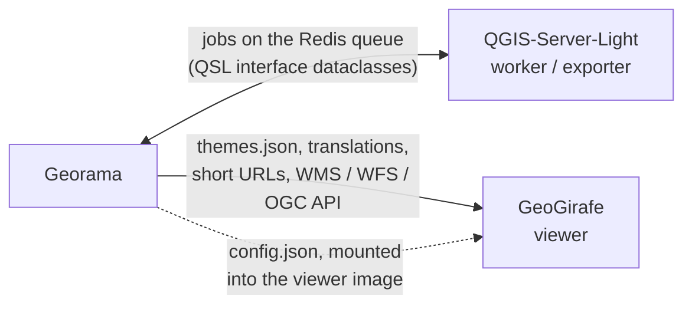
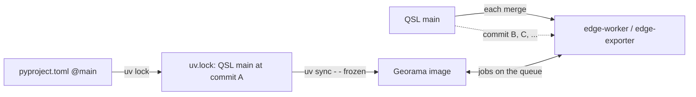

# Contracts With the Neighbours

Georama lives between two neighbours. On one side QGIS-Server-Light (QSL) renders the
maps and
exports the projects, on the other side GeoGirafe shows them to the users in the
browser.
Georama does not share code with either of them at runtime, it only agrees with them on
the
shape of what goes over the fence. These agreements are the contracts, and this page
tells
which ones exist, where they are pinned and who looks after them.



| Contract                   | Pinned in                                   | Checked by CI |
|----------------------------|---------------------------------------------|---------------|
| QSL interface on the queue | `pyproject.toml`, `uv.lock`, `compose.yml`  | yes           |
| GeoGirafe `themes.json`    | the format Georama writes, the viewer image | no            |
| GeoGirafe `config.json`    | `geogirafe/config.json`, the viewer image   | no            |

## QGIS-Server-Light: The Queue

Georama does not render a single map itself. It puts jobs on a Redis queue and waits
until a
QSL worker or exporter picks them up and writes the answer back. Both sides never call
each
other, they only agree on the shape of the jobs: the dataclasses of the QSL interface.
That
interface is the contract on the queue, and Georama is rather strict about which QSL it
signs
that contract with.

### Three Spots, One QSL

The QSL a Georama version runs with is written down in three places:

| Spot                                | What it pins                                 | Example of a release pin          |
|-------------------------------------|----------------------------------------------|-----------------------------------|
| `pyproject.toml`                    | the QSL package Georama dispatches jobs with | `qgis-server-light.git@v26.1`     |
| `compose.yml`, the worker service   | the image that renders the jobs              | `qgis-server-light:26.1-worker`   |
| `compose.yml`, the exporter service | the image that exports the projects          | `qgis-server-light:26.1-exporter` |

`uv.lock` follows `pyproject.toml` and resolves the package pin to one exact QSL commit.
The
Docker image installs with `uv sync --frozen`, so whatever is in the lock is what ends
up in
Georama.

All three spots have to name the same QSL state. If the package speaks one version of
the
interface and the worker another, Georama sends a job the worker reads differently, and
the
first one to notice is usually a user staring at an empty map.

### Three Kinds of Pin

The script `.github/scripts/qsl_pin.py` knows three kinds of pin:

| Kind     | Package pin           | Image tags                         | Moves?                        |
|----------|-----------------------|------------------------------------|-------------------------------|
| Release  | `@v26.1`              | `26.1-worker`, `26.1-exporter`     | never                         |
| QSL PR   | `@refs/pull/133/head` | `pr-133-worker`, `pr-133-exporter` | with each push to the QSL PR  |
| QSL main | `@main`               | `edge-worker`, `edge-exporter`     | with each merge into QSL main |

Only the release stands still. The other two are moving targets, and that is the whole
point of
the story.

### Why Main Is Not a Pin

Pinning `@main` looks like the friendliest choice: always the newest QSL, no release to
wait
for. It is a trap with a nice view, though:

- **The package stands still, the images do not.** `uv lock` freezes `@main` to the
  commit QSL
  main had at that moment. The `edge-worker` and `edge-exporter` images are rebuilt on
  every
  merge into QSL main. The morning after, the package in Georama and the worker in
  compose
  already speak two different versions of the interface, and no check in Georama notices
  it.
- **A release could not be rebuilt.** A Georama release on `@main` would ship whatever
  QSL main
  was that day. A month later nobody can tell which QSL belongs to it, and nobody can
  build it
  again the same way.
- **The release notes would have nothing to say.** Each Georama release opens with a
  block
  answering "which QSL do I run with this Georama", written by
  `.github/scripts/qsl_release_note.py`. That answer only exists for a QSL release.

A QSL PR pin has the same problems, it just moves less often.



Georama stays on commit A, the edge images went on to B and C.

### What the CI Checks

Three workflows look after the pin, each at its own moment:

| Workflow                | When                              | What it demands                                                    |
|-------------------------|-----------------------------------|--------------------------------------------------------------------|
| `qsl-version.yaml`      | every push and every PR to `main` | the three spots agree, `uv.lock` matches `pyproject.toml`          |
| `qsl-release-gate.yaml` | PRs to `main`                     | a draft may pin anything, a ready PR pins a release                |
| `release.yml`           | a Georama release                 | the pin is consistent and a release, before any image is published |

On a push to `main` itself `qsl-version.yaml` also demands a release, so a pin that
slipped
past the gate, e.g. by a bypass, still turns red there.

The gate tells you what it found:

```text
pyproject.toml package: @main
compose.yml worker: edge-worker
compose.yml exporter: edge-exporter
::error::pinned to QSL main, release QSL and bump the pin to it
```

### Working Against an Unreleased QSL

None of this forbids working with an unreleased QSL, it only keeps it out of `main`:

1. Open the Georama PR as a **draft** and pin the QSL PR (`@refs/pull/<n>/head`,
   `pr-<n>-worker`, `pr-<n>-exporter`) or QSL main (`@main`, `edge-worker`,
   `edge-exporter`).
   The gate passes with a notice that the pin has to become a release before the merge.
2. Run `uv lock` and commit `uv.lock` together with the pin, otherwise
   `qsl-version.yaml`
   reports a stale lock.
3. Once the QSL change is merged, release QSL.
4. Bump all three spots to that release, run `uv lock` again, commit and mark the PR as
   ready.

For local development there is no need to touch the pin at all:
`compose.dev_with_qsl.yml`
mounts your QSL checkout from `LOCAL_QSL_SOURCES` into Georama, where the entrypoint
swaps the
locked QSL for it, and builds the worker and exporter images from the same sources.

### Following QSL Main Without Pinning It

Two places already follow QSL main, so `main` of Georama never has to:

- **The edge image.** `edge_image.yml` builds the Georama edge image on every push to
  `main`
  and points QSL to `@main` just for that build, without committing it. The release pin
  in
  `pyproject.toml` stays for releases and PR images.
- **The compatibility run.** `qsl-compat.yaml` runs the Georama test suite against the
  sources
  of QSL main every Monday morning, and on demand against any QSL ref, e.g. `v26.2` or
  `refs/pull/<n>/head`. It is the early warning before a QSL release, not a pin.

## GeoGirafe: themes.json and config.json

GeoGirafe is a separate static application. It is served by its own image and knows
nothing
about Georama except two things: where to fetch its content from, and what that content
looks
like. Both are contracts, just quieter ones than the queue.

### themes.json: Georama Writes, GeoGirafe Reads

Everything GeoGirafe shows comes from Georama over HTTP:

| What              | Endpoint                                | Format                                                 |
|-------------------|-----------------------------------------|--------------------------------------------------------|
| Themes            | `webgis/themes/geogirafe/`              | `themes.json`                                          |
| Translations      | `webgis/themes/translation/<language>/` | the titles of themes and layers, keyed by the language |
| Short URLs        | `webgis/short`                          | the share links of GeoGirafe                           |
| Maps and features | `webgis/ows`, `webgis/api`              | WMS 1.3.0, WFS 2.0.0, OGC API - Features               |

The OGC services are described in [User Endpoints](get_started/endpoints.md).

The `themes.json` is the heart of it. Georama builds it from the dataclasses as
GeoGirafe
reads/understands it. The OGC services are standards and change
rarely, the `themes.json` is a format GeoGirafe owns and may extend or change with any
release.

### config.json: Georama Ships It, GeoGirafe Reads It

The configuration of the viewer lives in this repository, in `geogirafe/config.json` and
`geogirafe/config.mobile.json`. `compose.yml` mounts both into the viewer image. The
file ties
both sides together:

- it points GeoGirafe to the Georama endpoints above (`themes.url`,
  `languages.translations`,
  `share.getUrl` and `share.createUrl`),
- it names the OpenID Connect issuer and client (`oauth`) whose tokens Georama accepts,
- its keys and their meaning are defined by GeoGirafe, by the very version of the viewer
  image
  it is mounted into.

So the file is written by Georama but its schema belongs to GeoGirafe. A key that is
renamed in
a new viewer version is simply ignored by the old file, and the viewer falls back to its
default
without a word.

### One Pin, Nobody Watching

The GeoGirafe side is pinned in one spot only, the viewer image in `compose.yml`:

```yaml
geogirafe:
  image: geogirafe/viewer:1.3.0-dev.3079206142
```

That tag is the version of GeoGirafe the `themes.json` format and the `config.json` are
made
for. Unlike the QSL pin, no workflow checks this today: there is no gate for the image
tag, no
test of the `themes.json` against the viewer and no validation of `config.json` against
the
schema of the viewer. If GeoGirafe changes one of them, nothing in Georama turns red,
and the
first one to notice is again a user, this time looking at an empty layer tree.

Until a check exists, bumping the viewer image is a manual job:

1. Read the changelog of GeoGirafe between the old and the new version, look for changes
   to
   `themes.json` and to the configuration.
2. Compare `geogirafe/config.json` with the example configuration of the new version and
   carry
   over renamed or new keys.
3. Start the composition and walk through the viewer: themes load, the layer tree shows
   the
   translated titles, a share link opens, a login works and editing a feature saves.
4. Change the image tag in `compose.yml` together with any adaptation of the
   `themes.json`
   dataclasses or of `config.json`, in one PR, so the pieces of the contract travel
   together.
